# Active Directory Lab: Secure Users, Groups and File Access

I built a Windows Server 2022 domain from scratch, gave three users least-privilege access to company folders, turned on auditing, then deliberately broke the setup to see how the mistake shows up in the logs.

**Environment:** Windows Server 2022 domain controller in VMware · Domain `sheridantech.local` · PowerShell, Active Directory Users and Computers, Group Policy Management, Event Viewer
**Built as part of:** INFO33192 Windows Administration & Security, Sheridan College (Fall 2026)

## What I built

| Part | What I did |
|------|-----------|
| Users | Alice (staff), Bob (manager), Eve (contractor) in a dedicated OU, created from a disabled template account |
| Groups | `Standard_Users`, `Managers`, `Contractors`, one user per group |
| Policies | Domain password and lockout policy through Group Policy |
| Folders | `Confidential`, `Shared`, `Contractors` with group-based NTFS permissions |
| Testing | Script that tries to read and write each folder as each user |
| Auditing | Logon, group-change and file-access auditing, reviewed in the Security log |
| Break it | Added the contractor to Managers and traced what happened |

## 1. Users and groups

Each user belongs only to the group that matches their job.

```powershell
# List every account in the Lab3 OU and whether it's enabled
Get-ADUser -Filter * -SearchBase "OU=Lab3,DC=sheridantech,DC=local" | Select-Object Name, Enabled
# Show who is in each group
Get-ADGroupMember -Identity "Managers" | Select-Object Name
```

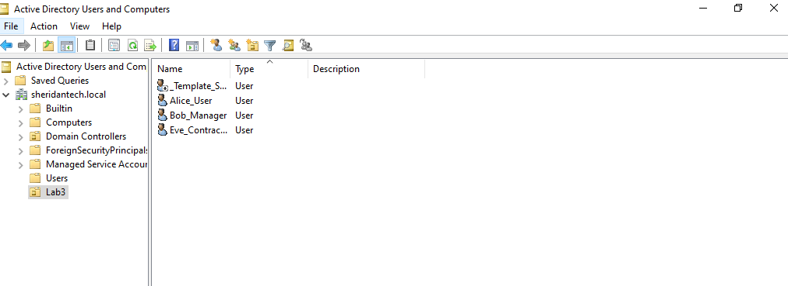
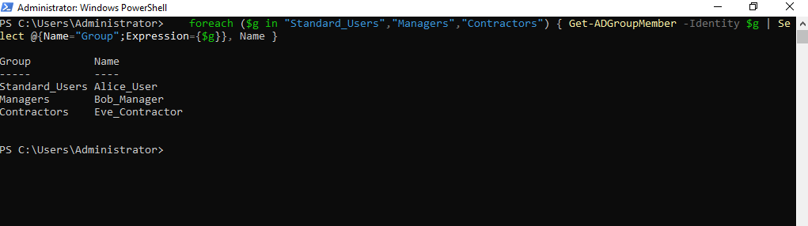

## 2. Password and lockout policy

Set in the Default Domain Policy:
- **Passwords:** 12+ characters, complexity on, 90-day maximum age, 24 remembered.
- **Lockout:** 5 failed attempts locks the account for 30 minutes.

```powershell
# Apply Group Policy now instead of waiting
gpupdate /force
# Show the password and lockout settings actually in effect
net accounts
```

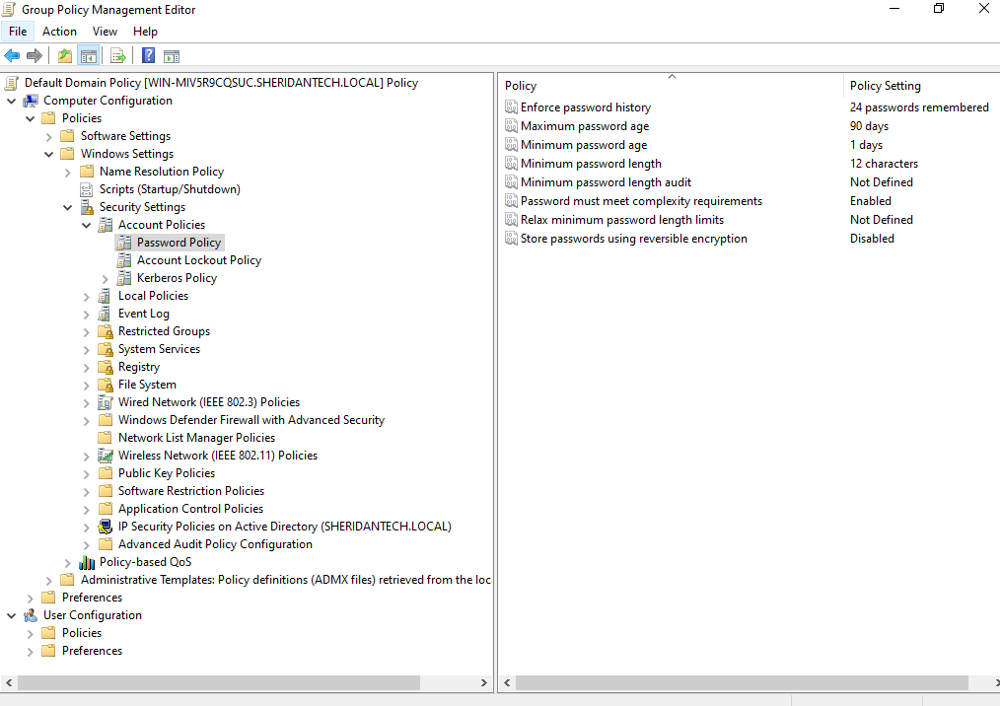
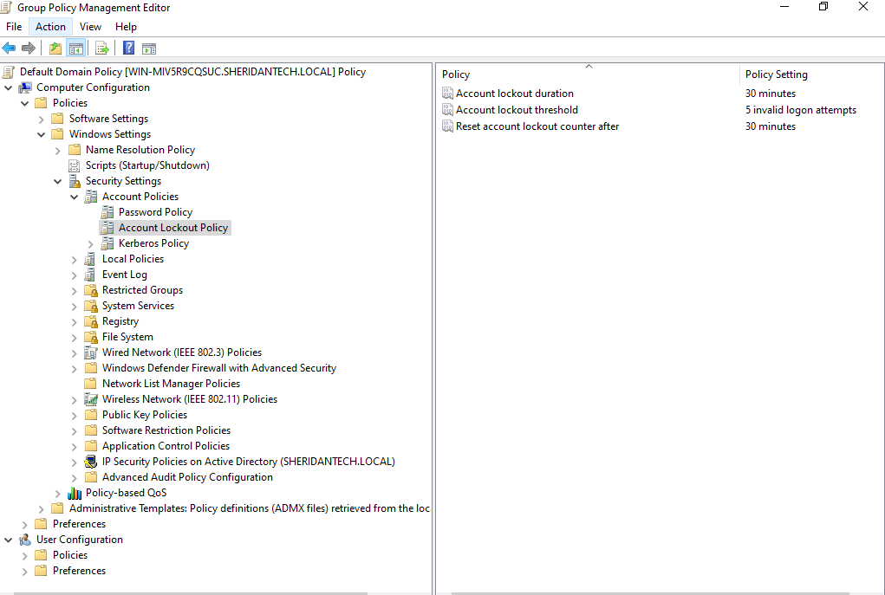
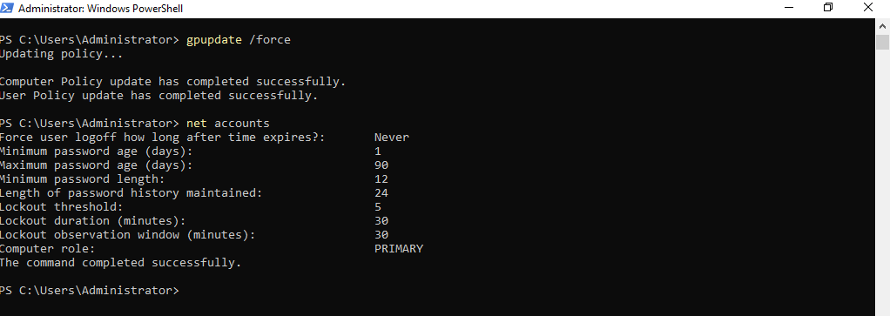

## 3. NTFS permissions (least privilege)

| Folder | Group | Access |
|--------|-------|--------|
| Confidential | Managers | Full control |
| Shared | Standard_Users | Read and write |
| Contractors | Contractors | Read only |

**Hardening step:** folders created on `C:\` give every domain user read access by default. I disabled inheritance and removed those entries; otherwise every user could read the data, however strong the passwords were.

```powershell
# Show who has what access on a folder ((F) = full, (RX) = read, (W) = write)
icacls C:\Lab3Data\Confidential
```

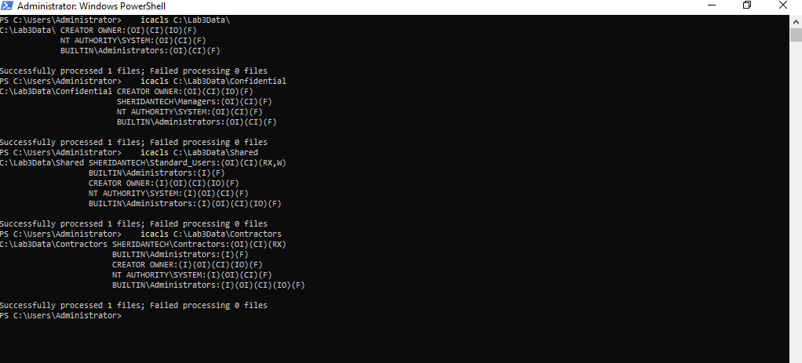

## 4. Testing access as each user

I signed in as each user and ran a script that tries to list and create a file in every folder.

| User | Confidential | Shared | Contractors |
|------|--------------|--------|-------------|
| Alice (staff) | Denied | Read + write | Denied |
| Bob (manager) | Read + write | Denied | Denied |
| Eve (contractor) | Denied | Denied | Read only |

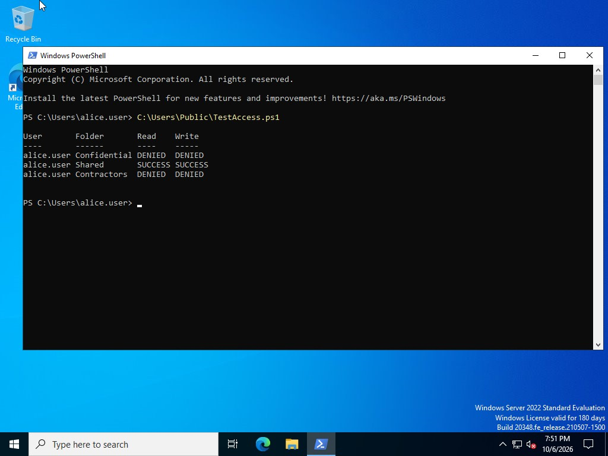
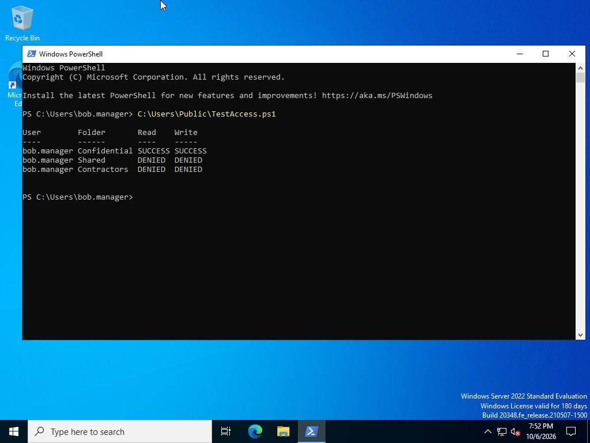
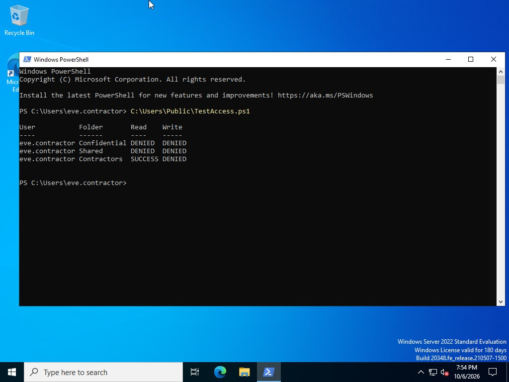

## 5. Auditing

I enabled auditing for logons, group changes and file access, and added an audit rule on the Confidential folder.

| Event ID | Meaning |
|----------|---------|
| 4624 | Successful logon |
| 4625 | Failed logon |
| 4663 | Attempt to access a file or folder |
| 4728 / 4729 | Member added to / removed from a security group |

```powershell
# Confirm which audit categories are active
auditpol /get /category:*
# Pull the latest failed logons from the Security log
Get-WinEvent -FilterHashtable @{LogName='Security'; Id=4625} -MaxEvents 5
```

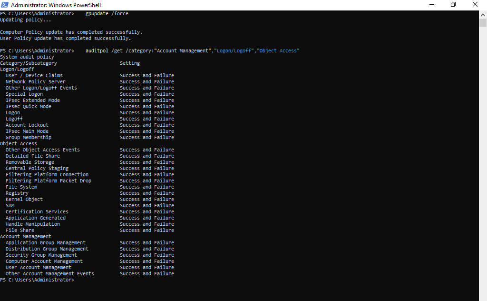
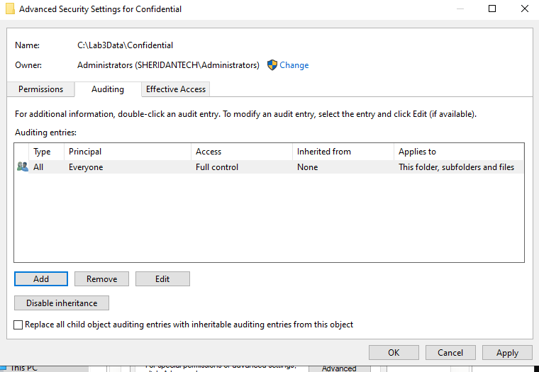
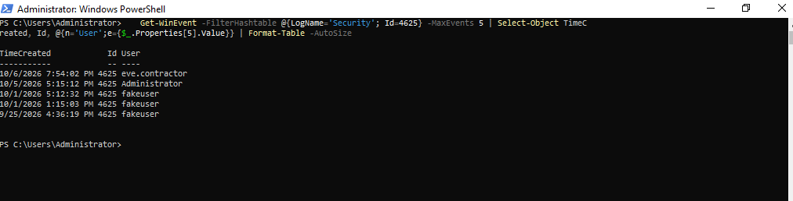
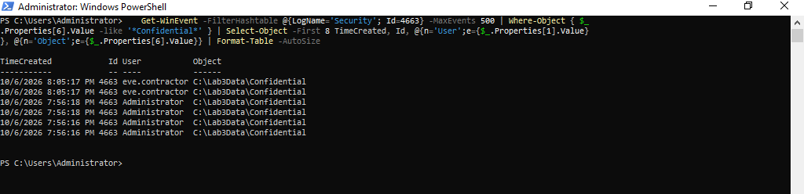

## 6. Breaking it on purpose: contractor added to Managers

**Scenario:** an admin mistakenly adds Eve, a contractor, to the Managers group.

1. **Eve added to Managers:**
   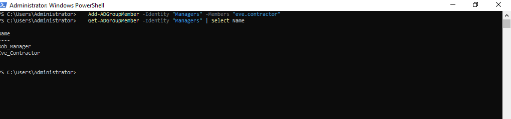
2. **After signing in again, Eve has full control of Confidential:**
   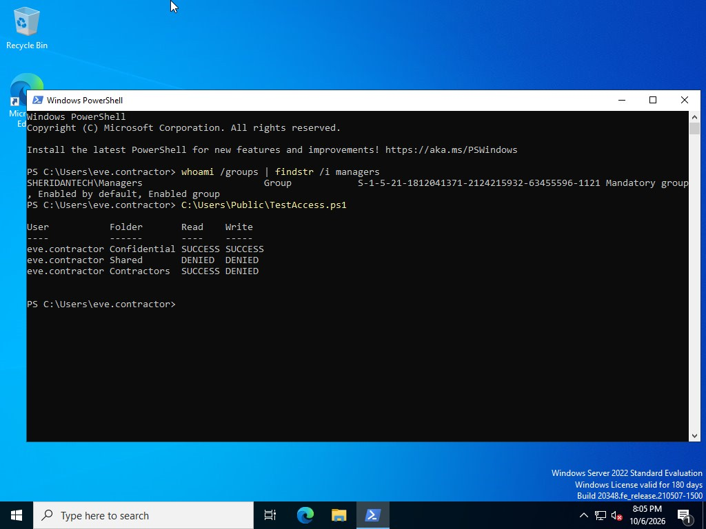
3. **Eve removed. Managers contains only Bob:**
   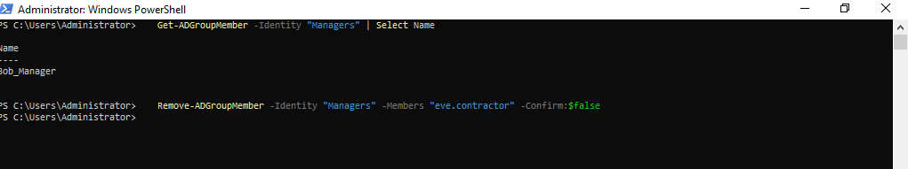
4. **After signing in again, access is denied:**
   
5. **The Security log recorded both changes:**
   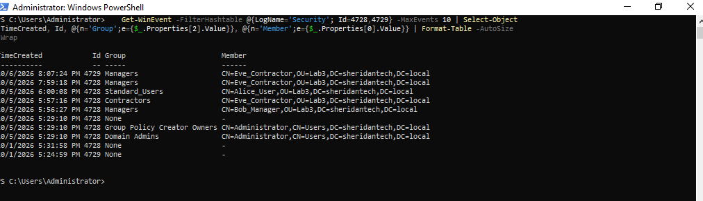

**What I noticed:** a session Eve already had open kept her old access. Group changes only apply after the user signs out and back in, because group membership is read into the access token at logon.

## What I learned

- **AD and NTFS are two layers that meet at group membership.** Eve's access was an AD mistake, but NTFS enforced it exactly as configured. One wrong group gave a contractor full control of confidential data.
- **Defaults aren't safe.** Inherited "Users can read" permissions would have exposed every folder.
- **This is what a SOC watches for.** Event 4728 on a privileged group, followed by 4663 on sensitive files, is the trail of privilege creep. Alerting on it, plus regular reviews of who's in privileged groups, catches this kind of mistake early.
- **PowerShell gave the most reliable verification.** In the GUI consoles it was easy to apply a permission to the wrong folder or edit the wrong policy.

## Troubleshooting

Problems I hit while building this lab are written up in my [IT Troubleshooting Log](https://github.com/ikassem-cyber/it-troubleshooting-log/blob/main/cases/01-active-directory.md).
